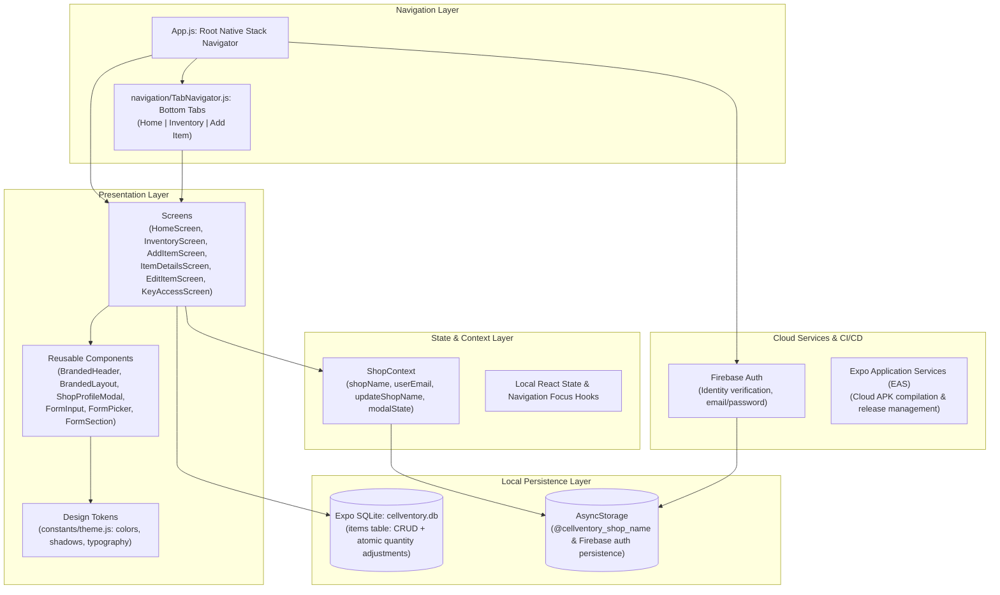
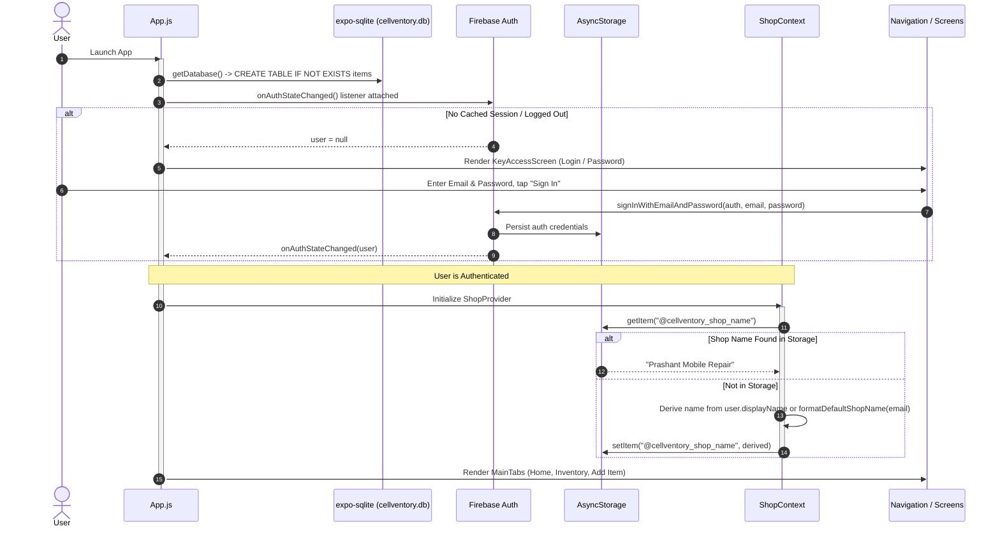
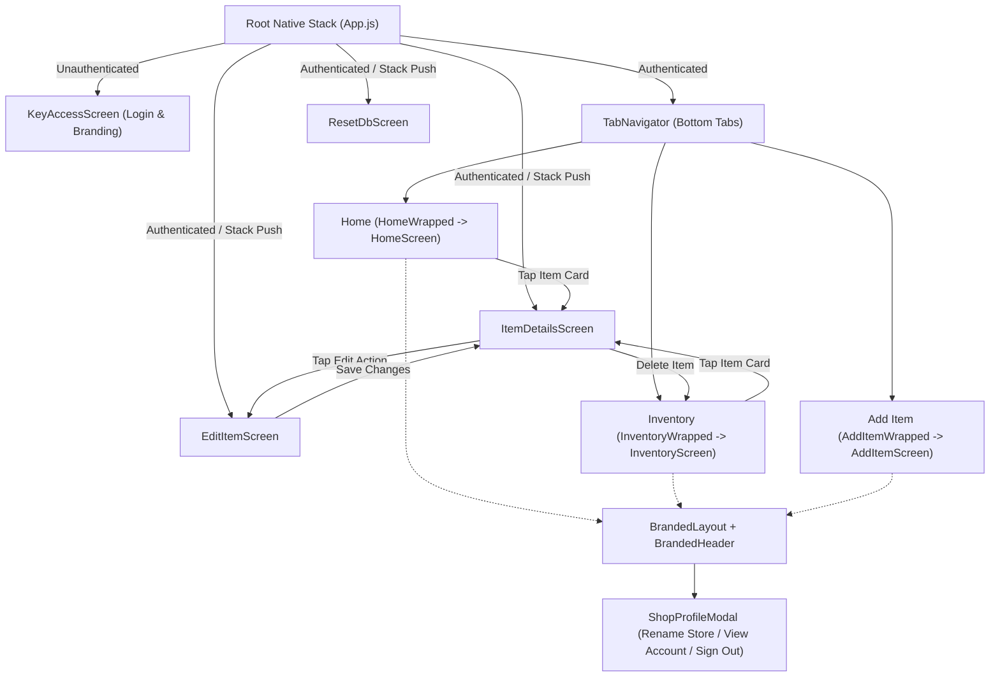
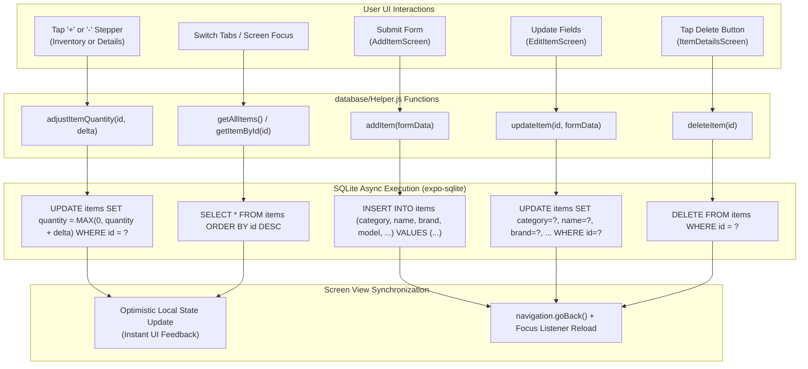
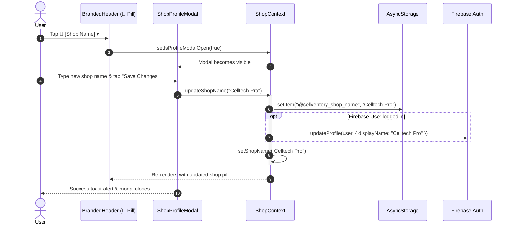

# Cellventory Architecture & Technical Documentation

> **CELLVENTORY by teqperts** — Mobile Inventory & Repair Part Management System  
> Architecture version: `1.0.0` | Target Platform: Android / iOS (via Expo)

---

## 1. System Overview & Core Principles

Cellventory is designed for retail shops, repair technicians, and small businesses needing an ultra-responsive, offline-first mobile inventory management solution.

### Core Architectural Principles

- **Offline-First Resilience**: All business data resides locally in an embedded SQLite database (`cellventory.db`). Operations such as inventory searching, category filtering, stock adjustments, and record creation execute with near-zero latency, even without an active internet connection.
- **Layered Separation of Concerns**: Clean isolation between Presentation (React Native components & screen layouts), Navigation (React Navigation v7), State Management (React Context + Hooks), and Data Access (`database/Helper.js` with Expo SQLite async API).
- **Lightweight State Architecture**: Avoids heavyweight global state libraries (like Redux or MobX). Local screen state combined with React Navigation focus listeners (`useFocusEffect` / `navigation.addListener('focus')`) provides automatic reactive data synchronization.
- **Secure Authentication**: Firebase Authentication v13 manages user credentials, backed by `@react-native-async-storage/async-storage` for persistent user sessions across application restarts.
- **Centralized Design System**: All colors, typography, elevations, border radii, and spacing tokens are declared in `constants/theme.js` to ensure visual harmony and maintainability.

---

## 2. High-Level System Architecture

The following diagram outlines the layers comprising the Cellventory mobile application:



---

## 3. End-to-End Application Flows

### 3.1. App Startup & Authentication Flow



---

### 3.2. Navigation & Screen Hierarchy



---

### 3.3. Inventory Data Flow & SQLite Lifecycle

All CRUD operations are routed through `database/Helper.js`:



---

### 3.4. Shop Customization & State Flow



---

### 3.5. EAS Build & Release Pipeline


---

## 4. Tools, Libraries & SDK Breakdown

| Category | Library / Tool | Version | Role in Architecture |
| :--- | :--- | :--- | :--- |
| **Framework & Engine** | `expo` | `^58.0.26` | Unified native mobile application framework, module lifecycle management, and prebuild engine. |
| **Core UI Runtime** | `react` | `19.3.0` | Declarative UI rendering, hooks lifecycle (`useState`, `useEffect`, `useCallback`, `useContext`). |
| **Native Mobile Bridge** | `react-native` | `0.88.1` | Native primitives (`View`, `Text`, `TouchableOpacity`, `TextInput`, `ScrollView`, `Alert`). |
| **Navigation Stack** | `@react-navigation/native` | `^7.1.14` | Core navigation container, deep linking support, and route listeners. |
| **Navigation Stack** | `@react-navigation/native-stack` | `^7.3.21` | High-performance native platform transitions between login, tabs, details, and editor screens. |
| **Navigation Tabs** | `@react-navigation/bottom-tabs` | `^7.4.2` | Bottom tab bar integration with badges, icons, and safe area insets. |
| **Local Database** | `expo-sqlite` | `~58.0.18` | Modern asynchronous SQLite API (`openDatabaseAsync`, `execAsync`, `runAsync`, `getAllAsync`, `getFirstAsync`). |
| **Persistent Key-Value Store**| `@react-native-async-storage/async-storage` | `2.2.0` | Cross-platform local key-value store for session persistence and shop metadata. |
| **Authentication Service** | `firebase` | `^13.4.0` | Modular Web/RN SDK v13 for identity management (`initializeAuth`, `signInWithEmailAndPassword`, `onAuthStateChanged`). |
| **Form Controls** | `@react-native-picker/picker` | `2.11.4` | Native dropdown picker for product categories and part types. |
| **Gestures & Animation** | `react-native-reanimated` | `4.7.1` | Hardware-accelerated 60fps native animations for screen transitions and micro-interactions. |
| **Gestures** | `react-native-gesture-handler` | `~3.3.0` | Touch handling and swipe gesture recognition. |
| **Safe Area Insets** | `react-native-safe-area-context` | `~5.11.1` | Automatic notch, dynamic island, and status/navigation bar inset calculation across device form factors. |
| **Iconography** | `@expo/vector-icons` | `^15.0.2` | Comprehensive vector icon families (`Feather`, `MaterialCommunityIcons`). |
| **Device Info & Keystore** | `expo-device`, `expo-secure-store` | `~58.0.x` | Native hardware capability detection and secure encrypted keychain storage. |
| **Build & Release Automation**| `eas-cli` / EAS Cloud | `27.11.0` | Cloud-based build worker orchestration producing installable native `.apk` files without local Android Studio setup. |
| **Testing Suite** | `jest`, `babel-jest` | `^30.5.2` | Automated unit testing engine for business logic, database queries, and context providers. |

---

## 5. Database Schema & Data Models

### 5.1. SQLite Relational Schema (`cellventory.db`)

#### Table: `items`

```sql
CREATE TABLE IF NOT EXISTS items (
  id INTEGER PRIMARY KEY AUTOINCREMENT,
  category TEXT,
  name TEXT NOT NULL,
  brand TEXT,
  model TEXT,
  part_type TEXT,
  quantity INTEGER DEFAULT 0,
  cost_price REAL,
  selling_price REAL,
  added_on TEXT,
  notes TEXT
);
```

#### Table: `customers`

```sql
CREATE TABLE IF NOT EXISTS customers (
  id INTEGER PRIMARY KEY AUTOINCREMENT,
  phone TEXT NOT NULL,
  purpose TEXT NOT NULL,
  name TEXT NOT NULL,
  device_model TEXT,
  email TEXT,
  address TEXT,
  notes TEXT,
  created_at TEXT
);
CREATE INDEX IF NOT EXISTS idx_customers_phone ON customers(phone);
```

#### Customer Field Specifications

| Column Name | SQL Type | Nullable | Description | Example Value |
| :--- | :--- | :--- | :--- | :--- |
| `id` | `INTEGER` | No (PK) | Auto-incrementing unique customer identifier | `1` |
| `phone` | `TEXT` | No | Customer mobile contact number (indexed for lookup) | `'9876543210'` |
| `purpose` | `TEXT` | No | Purpose of store visit (Repair, Purchase, Inquiry, etc.)| `'Repair / Service'` |
| `name` | `TEXT` | No | Customer full name | `'Rahul Verma'` |
| `device_model`| `TEXT` | Yes | Customer device brand and model | `'iPhone 13'` |
| `email` | `TEXT` | Yes | Customer email address | `'rahul@example.com'` |
| `address` | `TEXT` | Yes | Customer locality, area, or address | `'Connaught Place, Delhi'` |
| `notes` | `TEXT` | Yes | Notes, fault remarks, or customer preferences | `'Display replacement OEM'` |
| `created_at` | `TEXT` | Yes | ISO 8601 registration timestamp | `'2026-11-20T12:00:00.000Z'`|
```

#### Field Specifications

| Column Name | SQL Type | Nullable | Description | Example Value |
| :--- | :--- | :--- | :--- | :--- |
| `id` | `INTEGER` | No (PK) | Auto-incrementing unique record identifier | `101` |
| `category` | `TEXT` | No | Item classification category | `'Mobile Phone'`, `'Accessories'` |
| `name` | `TEXT` | No | Human-readable item / part name | `'iPhone 13 Display Screen'` |
| `brand` | `TEXT` | Yes | Device / component manufacturer | `'Apple'` |
| `model` | `TEXT` | Yes | Specific device model number or name | `'A2633 (iPhone 13)'` |
| `part_type` | `TEXT` | Yes | Repair part subtype (e.g. Screen, Battery, Port) | `'OLED Display'` |
| `quantity` | `INTEGER` | No | Stock quantity available on hand (default 0) | `14` |
| `cost_price` | `REAL` | Yes | Purchase price / acquisition cost | `4200.00` |
| `selling_price` | `REAL` | Yes | Retail selling / installation price | `6500.00` |
| `added_on` | `TEXT` | Yes | ISO 8601 creation timestamp | `'2026-11-20T10:15:30.000Z'` |
| `notes` | `TEXT` | Yes | Custom internal remarks, supplier info, etc. | `'OEM Grade A replacement'` |
| `imei` | `TEXT` | Yes | Device IMEI / serial barcode (indexed) | `'352099001761481'` |

#### Table: `customers` (Streamlined: Name & Phone)

| Column | SQLite Type | Nullable | Description | Example |
| :--- | :--- | :--- | :--- | :--- |
| `id` | `INTEGER` | No (PK) | Auto-increment primary key | `1` |
| `name` | `TEXT` | No | Customer full name | `'Amit Sharma'` |
| `phone` | `TEXT` | No | Customer mobile phone number (indexed) | `'9876543210'` |
| `created_at` | `TEXT` | Yes | ISO 8601 creation timestamp | `'2026-11-20T12:00:00.000Z'` |

#### Table: `repairs` (1-to-N Multi-Device Hardware Repair Orders)

| Column | SQLite Type | Nullable | Description | Example |
| :--- | :--- | :--- | :--- | :--- |
| `id` | `INTEGER` | No (PK) | Auto-increment primary key | `101` |
| `customer_id` | `INTEGER` | No (FK) | References `customers(id)` ON DELETE CASCADE | `1` |
| `device_model` | `TEXT` | No | Device brand and model | `'iPhone 13 Pro'` |
| `imei` | `TEXT` | Yes | 15-digit device IMEI (indexed, Luhn Mod-10 checked) | `'352099001761481'` |
| `issue` | `TEXT` | Yes | Reported problem / diagnostic remarks | `'Screen cracked & touch frozen'` |
| `purpose` | `TEXT` | Yes | Service intent (Repair / Service, Warranty, etc.) | `'Repair / Service'` |
| `status` | `TEXT` | Yes | Job state (In Progress, Ready for Delivery, Delivered) | `'In Progress'` |
| `delivery_date` | `TEXT` | Yes | Promised delivery date (YYYY-MM-DD) | `'2026-11-22'` |
| `estimated_cost` | `REAL` | Yes | Estimated quotation amount (default 0) | `4500.00` |
| `advance_paid` | `REAL` | Yes | Advance deposit collected (default 0) | `1500.00` |
| `notes` | `TEXT` | Yes | Technician repair notes | `'Replaced OEM OLED panel'` |
| `created_at` | `TEXT` | Yes | Intake timestamp | `'2026-11-21T00:00:00.000Z'` |
| `updated_at` | `TEXT` | Yes | Last update timestamp | `'2026-11-21T00:30:00.000Z'` |

---

### 5.2. Key-Value Storage Contract (`AsyncStorage`)

| Key | Value Type | Purpose |
| :--- | :--- | :--- |
| `@cellventory_shop_name` | `string` | Stored custom shop or business name displayed in header pill and profile modal. |
| `firebase:authUser:...` | `string` (JSON) | Cached Firebase authentication tokens and session refresh credentials. |

---

## 6. Directory Structure & Codebase Map

```text
cellventory/
├── App.js                      # Root bootstrap: DB init, Auth state, Root Stack Navigator
├── app.json                    # Expo config: slug, owner ("teqperts"), icons, splash
├── eas.json                    # EAS build profiles: development, preview (APK), production
├── index.js                    # Expo entrypoint
├── package.json                # Dependencies, npm@11.6.0 declaration, test scripts
│
├── assets/                     # Branding & graphics
│   ├── adaptive-icon.png       # Android adaptive launcher icon
│   ├── icon.png                # Standard app launcher icon
│   ├── splash.png              # Launch screen splash image
│   └── teqperts-logo.png       # Official Teqperts logo mark used in headers & login
│
├── config/                     # Third-party service configuration
│   └── firebase.js             # Firebase v13 app & auth init with AsyncStorage persistence
│
├── constants/                  # Unified design tokens
│   └── theme.js                # colors, typography, spacing, borderRadius, shadows
│
├── context/                    # React context providers
│   └── ShopContext.js          # Shop name state, persistence, and profile modal controller
│
├── database/                   # Data access layer
│   └── Helper.js               # SQLite connection cache, migrations, and CRUD helpers
│
├── navigation/                 # Routing & screen navigators
│   └── TabNavigator.js         # Bottom tabs: Home, Inventory, Customers
│
├── utils/                      # Core algorithms & helper utilities
│   └── imei.js                 # Luhn Mod-10 validator, check digit generator, barcode extractor
│
├── components/                 # Reusable UI presentation components
│   ├── BrandedHeader.js        # Teqperts logo + CELLVENTORY title + 🏪 Shop Pill + Sign Out
│   ├── BrandedLayout.js        # Safe area container & common page frame
│   ├── ShopProfileModal.js     # Modal for viewing account email & updating shop name
│   ├── IMEIScannerModal.js     # Camera barcode scanner modal (expo-camera, viewfinder, torch)
│   ├── AddDeviceModal.js       # Modal to intake additional device repair orders for a customer
│   ├── FormInput.js            # Standardized styled text inputs
│   ├── FormPicker.js           # Standardized dropdown selector
│   ├── FormSection.js          # Visual card container grouping related form inputs
│   └── ScreenWrapper.js        # Keyboard-avoiding scroll wrapper
│
├── screens/                    # Full screen views
│   ├── KeyAccessScreen.js      # Clean branded authentication screen
│   ├── HomeScreen.js           # Fast dashboard: Quick actions (+ Item, + Customer), stats, recents
│   ├── InventoryScreen.js      # Filter chips (All/Low/Out), search, badges, inline steppers
│   ├── CustomersScreen.js      # Customer directory, phone/IMEI search, WhatsApp/Call shortcuts
│   ├── AddCustomerScreen.js    # Mobile-first intake, smart phone suggestions, IMEI scanner
│   ├── EditCustomerScreen.js   # Customer profile editor with IMEI scanner support
│   ├── CustomerDetailsScreen.js# Full profile, 1-tap WhatsApp/Call, 1-tap IMEI Copy, conversion
│   ├── AddItemScreen.js        # New inventory addition form
│   ├── ItemDetailsScreen.js    # Detailed item inspection, pricing, margin, steppers, delete
│   ├── EditItemScreen.js       # Item edit form with preloaded values
│   ├── ResetDbScreen.js        # Developer / diagnostic database purge screen
│   └── wrapped/                # Tab screens wrapped in BrandedLayout
│       ├── HomeWrapped.js
│       ├── InventoryWrapped.js
│       └── CustomersWrapped.js
│
├── docs/                       # Project documentation
│   └── ARCHITECTURE.md         # This technical architecture document
│
└── __tests__/                  # Automated test suite (Jest)
    ├── auth.test.js            # Auth validation tests
    ├── database.test.js        # SQLite helper tests (CRUD + quantity steppers)
    ├── forms.test.js           # Form parsing and validation tests
    ├── shopContext.test.js     # Shop context and default shop name formatter tests
    ├── navigation.test.js      # Tab navigation tests
    ├── customers.test.js       # Customer database, CRUD, search, and WhatsApp tests
    ├── repairs.test.js         # Multi-device repair orders, 1:N relations, and Khata financials
    ├── customerSuggestions.test.js # Mobile auto-suggest and inquiry conversion tests
    ├── imei.test.js            # IMEI Luhn checksum calculation and barcode extraction tests
    └── imeiRouter.test.js      # Smart Universal IMEI Router & device triage tests
```

---

## 7. Security, Performance & Scalability Considerations

1. **Local SQLite Indexing**: As inventory exceeds 10,000 SKUs, query performance can be indexed on `category` and `name` (`CREATE INDEX idx_items_name ON items(name);`).
2. **Credential Safety**: Firebase API keys in `config/firebase.js` identify the Firebase client application. Authentication state is guarded by Firebase Identity Platform with strict email/password hashing on Google Cloud infrastructure.
3. **No Unnecessary Re-Renders**: Components leverage modular subscriptions and local state; large lists in `InventoryScreen.js` use `FlatList` with `keyExtractor` for optimized memory recycling.
4. **Cloud Migration Readiness**: The SQLite structure in `Helper.js` mirrors standard document schemas, making future bidirectional cloud sync (e.g. Cloud Firestore or Supabase) seamless if multi-device real-time sync is requested.
